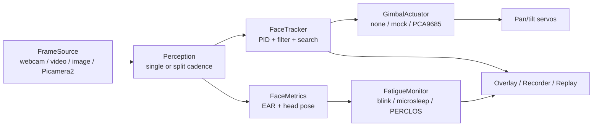

# Active Vision Face Monitoring Scaffold

[English](README.md) | [中文](README_CN.md)

[](https://github.com/lijiawei255/active-vision-face-monitoring-scaffold/actions/workflows/ci.yml)
[](LICENSE)
[](pyproject.toml)

> **Status: v0.1.1 alpha.** Desktop simulation, synthetic/real detector tests and a Windows
> webcam passive run are verified locally. Raspberry Pi hardware (Picamera2 + PCA9685 + servos)
> is implemented and contract-tested but **has not yet been executed on physical hardware** in
> this repository. See [Verification matrix](#verification-matrix).

A modular, hardware-agnostic Python scaffold for:

- **2-DOF PID gimbal face tracking** (pan/tilt, deadband, rate limits, anti-windup, search/re-acquire);
- **Real-time facial state monitoring**: EAR, blink/microsleep, PERCLOS and head-pose distraction;
- **Testing without the robot**: scriptable detectors, a virtual gimbal plant, JSONL replay and CI;
- **Passive mode**: camera only, no servos — tracking and fatigue monitoring still work, the
  desired pan/tilt angles are computed and logged but nothing physically moves.

It is a *reference architecture*, not a product, not a face-recognition system and not a
certified driver-monitoring device.

---

## What it is / what it is not

| It is | It is not |
|---|---|
| An engineering scaffold with explicit capture / perception / control / actuation seams | A turnkey desktop app or web dashboard |
| A tested PID + fatigue reference implementation | A medical device or safety-certified DMS |
| Hardware-agnostic: desktop webcam, Pi camera, mock servos, SIL plant | A face recognition / identity / embedding system |
| Designed for passive (camera-only) or active (camera + servos) operation | A cloud service; frames stay local by default |
| MIT-licensed, documented in English and Chinese | A copy of any unlicensed demo project |

---

## Features

- **Capture**: OpenCV webcam / video / image sources, Raspberry Pi Picamera2 source, latest-frame
  read, configurable camera flip.
- **Detection**:
  - `YuNet` (`cv2.FaceDetectorYN`) for fast tracking;
  - `MediaPipe Face Landmarker` (Tasks API) for 478 landmarks;
  - `single` detector mode or `split` mode (fast tracking detector + heavier landmark detector);
  - pinned model URLs with SHA-256 verification.
- **Tracking**: velocity-form PID (deg/s) with output/integral limits, anti-windup, deadband,
  EMA smoothing, observation TTL, search sweep, re-acquire.
- **Fatigue**: EAR, blink detection, microsleep, rolling PERCLOS with coverage/freshness checks,
  head pose (solvePnP), pose-gated EAR, EAR calibration, hysteresis and cooldown.
- **Actuation**: null (passive), mock (in-memory), PCA9685/ServoKit backend with explicit
  `auto` fallback; no blocking sleeps in `set_angle`.
- **Runtime**: single-threaded loop, latest-frame handling, stale-frame drop, JSONL session
  recording, annotated video (opt-in), run manifest with performance metrics.
- **Tooling**: `avfm run / simulate / replay / detect / calibrate / doctor / selftest / models`,
  `pytest` suite, `ruff`, GitHub Actions, pre-commit, bilingual docs.

---

## Operating modes

| Mode | Camera | Actuator | In-frame tracking | Fatigue | Physical search | Use case |
|---|---|---|---|---|---|---|
| **Active** | Pi Cam / webcam | PCA9685 + servos | closed loop | yes | yes | full gimbal tracking |
| **Passive** | Pi Cam / webcam | `none` | yes + desired angles | yes | **no** | camera but no servos |
| **Desktop mock** | webcam | `mock` | yes + virtual commands | yes | no (camera does not move) | desktop demos/tests |
| **SIL** | virtual | virtual plant | closed loop | simulated | yes | verify control without hardware |

**Passive mode is a first-class mode**, not an error. If a face leaves the frame, the state becomes
`FACE_LOST`; the software does **not** pretend to scan. When the face returns it reports
`FACE_ACQUIRED` and resumes. Fatigue monitoring is independent of the actuator.

### Performance profiles

| Profile | Resolution / FPS | Tracking detector | Fatigue detector | Notes |
|---|---|---|---|---|
| `desktop` | 640×480 @ 15 | single MediaPipe/YuNet, every frame | same detector | Windows laptop |
| `rpi` | 640×480 @ 15 | YuNet every frame | MediaPipe every 2 frames | default Pi profile |
| `rpi_low_power` | 480×360 @ 10 | YuNet every 2 frames | MediaPipe every 3 frames | heat/throttling fallback |
| `rpi_passive` | 640×480 @ 15 | YuNet every frame | MediaPipe every 2 frames | Pi camera, no servos |
| `rpi_tracking_only` | 640×480 @ 15 | YuNet every frame | disabled | no MediaPipe |

The Pi cadence mirrors the parent project, which was measured on a Pi 5 at 640×480@15fps with
Haar every frame and MediaPipe every 2 frames. The new code still needs its own hardware benchmark
(see [docs/en/performance.md](docs/en/performance.md)).

---

## Quick start (Windows, no servos — passive mode)

```powershell
git clone https://github.com/lijiawei255/active-vision-face-monitoring-scaffold.git
cd active-vision-face-monitoring-scaffold

conda create -n avfm python=3.11 -c conda-forge -y
conda run -n avfm python -m pip install -U pip
conda run -n avfm python -m pip install -e ".[dev,mediapipe]"

conda run -n avfm avfm models download --all
conda run -n avfm avfm selftest
conda run -n avfm avfm run --source webcam:0 --profile desktop --servo none --show
```

- `--show` opens a window with the face box, EAR/PERCLOS, state and desired pan/tilt.
- `--servo none` means passive mode: no servos, no physical search.
- Without `--show`, it runs headless; `Ctrl+C` stops.
- Use `--record-dir var/session` to write `run.json` + `session.jsonl` (no pixels by default).
- Use `--record-video` with `--record-dir` for an annotated MP4 (explicit opt-in).

### Raspberry Pi 5 + camera + servos

```bash
conda create -n avfm python=3.11 -c conda-forge -y
conda run -n avfm python -m pip install -e ".[dev,mediapipe,rpi]"
conda run -n avfm avfm models download --all
conda run -n avfm avfm doctor --probe-camera --probe-actuator
conda run -n avfm avfm run --source picamera --servo pca9685 --config configs/rpi.toml
```

### Raspberry Pi 5 + camera, **no servos** (passive)

```bash
conda run -n avfm avfm run --source picamera --servo none --config configs/rpi_passive.toml
```

If you have no Pi at all, use `avfm simulate` to exercise the PID/search loop against a virtual
gimbal plant:

```bash
conda run -n avfm avfm simulate --scenario step --duration 12
conda run -n avfm avfm simulate --scenario sine --duration 12
conda run -n avfm avfm simulate --scenario lost --duration 14
```

---

## Architecture



Key contracts:

- `Frame.image` is always **BGR uint8 HxWx3**.
- `BBox` is normalised to `[0,1]` (origin top-left).
- PID output is **degrees/second**; `dt` is seconds.
- Tracking detection and PID run at different cadences; the tracker holds the last observation for
  a short TTL and the PID runs every frame.
- MediaPipe runs on RGB; the wrapper converts from the project-wide BGR contract.

See [docs/en/architecture.md](docs/en/architecture.md) for the full contract.

---

## Hardware reference (active mode)

| Part | Role | Connection |
|---|---|---|
| Raspberry Pi 5 | host | — |
| OV5647 CSI camera | frames | MIPI CSI-2 |
| PCA9685 | 16-ch PWM driver | I2C 0x40, SDA GPIO2 / SCL GPIO3 |
| SG90 pan servo | horizontal | PCA9685 CH2 |
| SG90 tilt servo | vertical | PCA9685 CH3 |
| External 5V ≥2A supply | servo power | common ground with Pi |

> Servos must use an external 5V supply, not the Pi 5V rail. Keep mechanical limits
> (`pan 40–180°`, `tilt 0–140°` in the reference build), add strain relief for the CSI cable, and
> test with `--servo none` first.

The reference camera is mounted upside-down, so `configs/rpi.toml` sets `flip = "vertical"`.
The parent project used the same mounting.

---

## Why YuNet and MediaPipe Tasks?

- **OpenCV 5 removed `cv2.CascadeClassifier` from the core module and the pip wheels no longer
  ship `cv2.data/haarcascades`.** The old Haar-based code would fail on a current install.
  We use `cv2.FaceDetectorYN` (YuNet) instead.
- **MediaPipe 0.10.31+ removed `mp.solutions`.** The old `mp.solutions.face_mesh` code would fail
  on MediaPipe 1.x. We use `mp.tasks.vision.FaceLandmarker` with a downloaded `.task` model.
- Models are **not committed**; `avfm models download` uses pinned URLs and SHA-256 checks.
  See [docs/en/architecture.md](docs/en/architecture.md#models) for URLs and hashes.

---

## Verification matrix

| Layer | Windows laptop | Raspberry Pi 5 |
|---|---|---|
| Unit / integration / SIL / cadence / CLI tests | ✅ 132 passed, 81% coverage (Python 3.11.17, OpenCV 5.0.0, MediaPipe 1.1.1) | ✅ pure Python; not run on Pi yet |
| YuNet + MediaPipe on public-domain image | ✅ 1 face, 478 landmarks, EAR 0.308 | not run |
| Windows webcam capture / passive loop | ✅ 58 frames in 5s, ~11.5 fps, avg loop ~15.9 ms; **no face was guaranteed in front of the camera during the automated run** | n/a |
| Webcam real-face tracking | ⚠️ not controlled in this automated run; detector accuracy is covered by the image test | n/a |
| Picamera2 capture | contract test only | ⏳ HIL pending |
| PCA9685 + servo sweep | contract test only | ⏳ HIL pending |
| Active gimbal tracking | SIL only | ⏳ HIL pending |
| Annotated video recording | ✅ MP4 written | n/a |

The parent project (`BJTU_Desktop-Learing-Assistant`) was measured on a Pi 5 and its tracking and
distraction detection were verified there. That is **prior evidence**, not a verification of this
new codebase. This repository includes `scripts/rpi_smoke.py` and `scripts/rpi_bench.py` to run
the HIL checks when hardware is available.

---

## Prior art and positioning

Fatigue-only projects and tracking-only demos exist, but the intersection is thin:

- `e-candeloro/Driver-State-Detection` (MIT, 157★) — webcam DMS with MediaPipe/PERCLOS/tests;
  no gimbal or active vision.
- `TianxingWu/face-tracking-pan-tilt-camera` (MIT, 245★) — PC + STM32 2-DOF face tracking;
  no fatigue, no automated tests.
- `pimoroni/PanTiltFacetracker` (50★, **no license**) and `pageauc/face-track-demo`
  (45★, **no license**) — Pi tracking demos; no fatigue/tests; code cannot be reused.
- `akshaybahadur21/Drowsiness_Detection` (MIT, 548★) — classic EAR demo; no gimbal/tests.
- `sahnimanas/Fatigue-Detection` (58★, **no license**) — PERCLOS demo; no gimbal.
- `Quackieduckie/tracking-screen` (1★, **no license**) — MediaPipe pan-tilt + scanning;
  no fatigue/tests.
- `LumiTrack` (0★, **no license**) — SIL PID gimbal platform in a different domain.

**Positioning:** a *maintained, licensed, tested scaffold* that connects 2-DOF PID active vision,
fatigue indicators, passive/no-servo operation, SIL/replay and a Raspberry Pi reference backend.
The value is integration and testability, not a new algorithm.

More detail: [docs/en/prior-art.md](docs/en/prior-art.md).

---

## Configuration

Profiles live in [`configs/`](configs/):

- `default.toml` — all defaults and comments;
- `desktop.toml` — webcam + passive mode;
- `rpi.toml` — Picamera2 + PCA9685 + split detection;
- `rpi_passive.toml` — Picamera2, no servos;
- `rpi_low_power.toml` — lower resolution/FPS and slower cadence;
- `rpi_tracking_only.toml` — YuNet only, no MediaPipe/fatigue;
- `demo_short.toml` — **demo-only** 10/15 s acceleration; never loaded by normal profiles.

Use `--profile rpi`, `--config path.toml`, or CLI overrides such as
`--detector-mode split --tracking-backend yunet --fatigue-backend mediapipe --servo none`.
`avfm run --dry-run --json` prints the fully resolved configuration.

---

## Testing

```bash
# Core (no webcam/hardware)
conda run -n avfm python -m pytest -m "not webcam and not hardware and not mediapipe" \
  --cov=avfm --cov-fail-under=80

# Real MediaPipe model
conda run -n avfm python -m pytest -m mediapipe --run-mediapipe

# Local webcam (opt-in)
conda run -n avfm python -m pytest -m webcam --run-webcam

# Raspberry Pi hardware (opt-in, when available)
conda run -n avfm python -m pytest -m hardware --run-hardware
```

`tests/data/astronaut.jpg` is a resized derivative of the scikit-image `astronaut` sample
(NASA Great Images, public domain, Eileen Collins). It is used only as a detector fixture;
see [tests/data/README.md](tests/data/README.md).

---

## Privacy, safety and scope

- Frames are processed locally. Nothing is uploaded by the runtime.
- No face recognition, identity database or embeddings.
- Recording is **off by default**; `--record-video` is explicit. JSONL stores boxes/metrics/events,
  not pixels.
- Fatigue indicators are **heuristic**. This is **not a medical device** and **not a certified
  driver-monitoring system**; do not use it for safety-critical decisions.
- If you monitor people at work, in a vehicle or in a classroom, you are responsible for complying
  with local law and obtaining informed consent (e.g., GDPR / Australian Privacy Act).
- Servo power and mechanical limits are the builder's responsibility. Use an external 5V supply,
  common ground, current-limited testing and an emergency stop.

---

## License and provenance

MIT — see [LICENSE](LICENSE) and [THIRD_PARTY_LICENSES.md](THIRD_PARTY_LICENSES.md).

The vision subsystem was extracted and rewritten from the MIT-licensed
[BJTU_Desktop-Learing-Assistant](https://github.com/lijiawei255/BJTU_Desktop-Learing-Assistant).
See [docs/en/provenance.md](docs/en/provenance.md) for the source commit and behavioural changes.

---

## Roadmap

- Raspberry Pi HIL measurements and a published performance table.
- Optional serial servo backend (ESP32/STM32) and a documented line protocol.
- Yawn / gaze indicators.
- ONNX detector alternatives and multi-face selection strategies.
- MkDocs/GitHub Pages documentation site and PyPI publication.

See [docs/en/roadmap.md](docs/en/roadmap.md).
