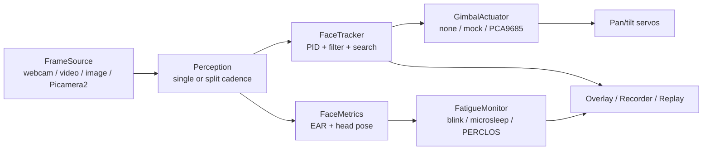

# 主动视觉人脸监测脚手架（Active Vision Face Monitoring Scaffold）

[English](README.md) | [中文](README_CN.md)

[](https://github.com/lijiawei255/active-vision-face-monitoring-scaffold/actions/workflows/ci.yml)
[](LICENSE)
[](pyproject.toml)

> **状态：v0.1.0 alpha。** 桌面 SIL、合成/真实检测器测试和 Windows 摄像头 passive 实跑已在本地验证；
> 树莓派硬件（Picamera2 + PCA9685 + 舵机）代码与契约测试已完成，但**尚未在本仓库中上真实硬件执行**。
> 详见[验证矩阵](#验证矩阵)。

一个模块化、硬件无关的 Python 工程脚手架，面向：

- **2-DOF PID 云台人脸跟踪**（pan/tilt、死区、速率限制、抗积分饱和、丢脸扫描/重捕获）；
- **实时面部状态监测**：EAR、眨眼/微睡眠、PERCLOS、头部姿态分心；
- **没有机器人也能测试**：可脚本化检测器、虚拟云台被控对象、JSONL 回放和 CI；
- **Passive 模式**：只有摄像头、没有舵机时，跟踪和疲劳检测照常工作，期望 pan/tilt 角照常计算并记录，
  但不会驱动物理舵机。

它是**参考架构**，不是产品、不是人脸识别系统，也不是经过认证的驾驶员监控设备。

---

## 它是什么 / 不是什么

| 是 | 不是 |
|---|---|
| 有明确采集/感知/控制/执行器边界的工程脚手架 | 开箱即用的桌面应用或 Web 仪表盘 |
| 经过测试的 PID + 疲劳检测参考实现 | 医疗器械或安全认证 DMS |
| 硬件无关：桌面摄像头、Pi 摄像头、Mock 舵机、SIL plant | 人脸识别/身份/embedding 系统 |
| 支持 passive（只有摄像头）和 active（摄像头 + 舵机） | 云服务；默认帧数据只留在本地 |
| MIT 许可，中英双语文档 | 对任何无许可证 demo 项目的复制 |

---

## 功能

- **采集**：OpenCV 摄像头/视频/图片源，树莓派 Picamera2 源，latest-frame 读取，可配置画面翻转。
- **检测**：
  - `YuNet`（`cv2.FaceDetectorYN`）用于快速跟踪；
  - `MediaPipe Face Landmarker`（Tasks API）用于 478 个关键点；
  - `single` 单检测器模式或 `split` 拆分模式（快速跟踪检测器 + 较重关键点检测器）；
  - 固定 URL + SHA-256 校验模型下载。
- **跟踪**：速度式 PID（输出 °/s），输出/积分限幅、抗饱和、死区、EMA 平滑、观测 TTL、扫描、重捕获。
- **疲劳**：EAR、眨眼、微睡眠、带覆盖率/新鲜度检查的滚动 PERCLOS、头部姿态（solvePnP）、
  姿态门控 EAR、EAR 校准、迟滞和事件冷却。
- **执行器**：null（passive）、mock（内存）、PCA9685/ServoKit，支持显式 `auto` 降级；
  `set_angle` 不再阻塞 sleep。
- **运行时**：单线程循环、latest-frame、过期帧丢弃、JSONL 会话记录、带标注视频（显式开启）、
  含性能指标的 run manifest。
- **工具链**：`avfm run / simulate / replay / detect / calibrate / doctor / selftest / models`、
  `pytest`、`ruff`、GitHub Actions、pre-commit、双语文档。

---

## 运行模式

| 模式 | 相机 | 执行器 | 画面内跟踪 | 疲劳检测 | 物理扫描 | 用途 |
|---|---|---|---|---|---|---|
| **Active** | Pi Cam / Webcam | PCA9685 + 舵机 | 闭环 | 有 | 有 | 完整云台跟踪 |
| **Passive** | Pi Cam / Webcam | `none` | 有 + 期望角度 | 有 | **无** | 有摄像头、没舵机 |
| **Desktop mock** | Webcam | `mock` | 有 + 虚拟命令 | 有 | 无（相机不动） | 桌面演示/测试 |
| **SIL** | 虚拟 | 虚拟 plant | 闭环 | 可模拟 | 有 | 无硬件验证控制 |

**Passive 是一等模式，不是错误。** 人脸离开画面后进入 `FACE_LOST`，软件不会假装在扫描；
人脸回来后报告 `FACE_ACQUIRED` 并恢复。疲劳检测与执行器无关。

### 性能档

| Profile | 分辨率/FPS | 跟踪检测 | 疲劳检测 | 说明 |
|---|---|---|---|---|
| `desktop` | 640×480 @ 15 | 单检测器 MediaPipe/YuNet，每帧 | 同跟踪检测器 | Windows 笔记本 |
| `rpi` | 640×480 @ 15 | YuNet 每帧 | MediaPipe 每 2 帧 | Pi 默认 |
| `rpi_low_power` | 480×360 @ 10 | YuNet 每 2 帧 | MediaPipe 每 3 帧 | 发热/卡顿降级 |
| `rpi_passive` | 640×480 @ 15 | YuNet 每帧 | MediaPipe 每 2 帧 | Pi 摄像头、无舵机 |
| `rpi_tracking_only` | 640×480 @ 15 | YuNet 每帧 | 关闭 | 不装 MediaPipe |

Pi 的 cadence 参考父项目：父项目在 Pi 5 上以 640×480@15fps、Haar 每帧 + MediaPipe 每 2 帧实测通过。
新代码仍需自己的硬件基准，见 [docs/zh/performance.md](docs/zh/performance.md)。

---

## 快速开始（Windows，无舵机 — passive 模式）

```powershell
git clone https://github.com/lijiawei255/active-vision-face-monitoring-scaffold.git
cd active-vision-face-monitoring-scaffold

conda create -n avfm python=3.11 -c conda-forge -y
conda run -n avfm python -m pip install -U pip
conda run -n avfm python -m pip install -e ".[dev,mediapipe]"

conda run -n avfm avfm models download --all
conda run -n avfm avfm selftest
conda run -n avfm avfm run --source webcam:0 --servo none --show
```

- `--show` 打开窗口，显示人脸框、EAR/PERCLOS、状态和期望 pan/tilt。
- `--servo none` 表示 passive：没有舵机，也没有物理扫描。
- 不加 `--show` 为无头模式；`Ctrl+C` 停止。
- `--record-dir var/session` 写 `run.json` + `session.jsonl`（默认不含像素）。
- `--record-video` 配合 `--record-dir` 写带标注 MP4（显式开启）。

### 树莓派 5 + 摄像头 + 舵机

```bash
conda create -n avfm python=3.11 -c conda-forge -y
conda run -n avfm python -m pip install -e ".[dev,mediapipe,rpi]"
conda run -n avfm avfm models download --all
conda run -n avfm avfm doctor --probe-camera --probe-actuator
conda run -n avfm avfm run --source picamera --servo pca9685 --config configs/rpi.toml
```

### 树莓派 5 + 摄像头，**无舵机**（passive）

```bash
conda run -n avfm avfm run --source picamera --servo none --config configs/rpi_passive.toml
```

完全没有 Pi 时，可用 `avfm simulate` 对虚拟云台 plant 跑 PID/扫描：

```bash
conda run -n avfm avfm simulate --scenario step --duration 12
conda run -n avfm avfm simulate --scenario sine --duration 12
conda run -n avfm avfm simulate --scenario lost --duration 14
```

---

## 架构



关键契约：

- `Frame.image` 永远是 **BGR uint8 HxWx3**。
- `BBox` 归一化到 `[0,1]`（原点左上）。
- PID 输出是 **°/s**；`dt` 是秒。
- 跟踪检测和 PID 可以不同频；tracker 在短 TTL 内保持最后观测，PID 每帧运行。
- MediaPipe 要 RGB；wrapper 从项目统一的 BGR 契约转换。

完整契约见 [docs/zh/architecture.md](docs/zh/architecture.md)。

---

## 硬件参考（active 模式）

| 部件 | 作用 | 连接 |
|---|---|---|
| Raspberry Pi 5 | 主机 | — |
| OV5647 CSI 摄像头 | 图像 | MIPI CSI-2 |
| PCA9685 | 16 路 PWM 驱动 | I2C 0x40，SDA GPIO2 / SCL GPIO3 |
| SG90 pan 舵机 | 水平 | PCA9685 CH2 |
| SG90 tilt 舵机 | 俯仰 | PCA9685 CH3 |
| 外部 5V ≥2A 电源 | 舵机供电 | 与 Pi 共地 |

> 舵机必须外部 5V 供电，不能从 Pi 5V 取电。参考结构限位 `pan 40–180°`、`tilt 0–140°`；
> CSI 线要留应力释放；先 `--servo none` 验证，再接舵机。

参考摄像头是倒装的，所以 `configs/rpi.toml` 设置 `flip = "vertical"`；父项目也是同样安装。

---

## 为什么用 YuNet 和 MediaPipe Tasks？

- **OpenCV 5 把 `cv2.CascadeClassifier` 移出了核心模块，pip wheel 也不再带
  `cv2.data/haarcascades`。** 旧 Haar 代码在当前安装上会失败。我们改用
  `cv2.FaceDetectorYN`（YuNet）。
- **MediaPipe 0.10.31+ 移除了 `mp.solutions`。** 旧 `mp.solutions.face_mesh` 在 MediaPipe 1.x
  上会失败。我们改用 `mp.tasks.vision.FaceLandmarker` + 下载的 `.task` 模型。
- 模型**不提交仓库**；`avfm models download` 使用固定 URL + SHA-256 校验。
  模型 URL/hash 见 [docs/zh/architecture.md](docs/zh/architecture.md#模型)。

---

## 验证矩阵

| 层级 | Windows 笔记本 | Raspberry Pi 5 |
|---|---|---|
| 单元/集成/SIL/cadence/CLI | ✅ 121 passed，81% 覆盖率（Python 3.11.17, OpenCV 5.0.0, MediaPipe 1.1.1） | ✅ 纯 Python；尚未在 Pi 上跑 |
| YuNet + MediaPipe 公有领域图 | ✅ 1 张脸、478 landmarks、EAR 0.308 | 未执行 |
| Windows 摄像头采集 / passive 循环 | ✅ 5 秒 58 帧，约 11.5 fps，平均 loop 约 15.9 ms；**自动测试期间不保证镜头前有人脸** | n/a |
| 摄像头真人脸跟踪 | ⚠️ 本次自动运行未受控；检测精度由测试图覆盖 | n/a |
| Picamera2 采集 | 仅契约测试 | ⏳ HIL 待执行 |
| PCA9685 + 舵机扫角 | 仅契约测试 | ⏳ HIL 待执行 |
| Active 云台跟踪 | 仅 SIL | ⏳ HIL 待执行 |
| 带标注视频录制 | ✅ 已写出 MP4 | n/a |

父项目 `BJTU_Desktop-Learing-Assistant` 在 Pi 5 上实测过跟踪和走神检测；那是**先验证据**，
不是本仓库新代码的验证结论。仓库提供 `scripts/rpi_smoke.py` 和 `scripts/rpi_bench.py`，
有硬件后可执行 HIL。

---

## 参考项目与定位

疲劳检测和跟踪分别都有不少项目，但交集很薄：

- `e-candeloro/Driver-State-Detection`（MIT，157★）— Webcam DMS，MediaPipe/PERCLOS/测试；
  无云台/主动视觉。
- `TianxingWu/face-tracking-pan-tilt-camera`（MIT，245★）— PC + STM32 2-DOF 人脸跟踪；
  无疲劳、无自动化测试。
- `pimoroni/PanTiltFacetracker`（50★，**无许可证**）、`pageauc/face-track-demo`
  （45★，**无许可证**）— Pi 跟踪 demo；无疲劳/测试；代码不可复用。
- `akshaybahadur21/Drowsiness_Detection`（MIT，548★）— 经典 EAR demo；无云台/测试。
- `sahnimanas/Fatigue-Detection`（58★，**无许可证**）— PERCLOS demo；无云台。
- `Quackieduckie/tracking-screen`（1★，**无许可证**）— MediaPipe 云台跟踪 + 扫描；
  无疲劳/测试。
- `LumiTrack`（0★，**无许可证**）— 不同领域的 SIL PID 云台平台。

**定位：** 一个**有维护、有许可证、有测试**的脚手架，把 2-DOF PID 主动视觉、疲劳指标、
passive/无舵机运行、SIL/回放和树莓派参考后端连起来。价值在集成与可验证性，不是新算法。

更多见 [docs/zh/prior-art.md](docs/zh/prior-art.md)。

---

## 配置

配置在 [`configs/`](configs/)：

- `default.toml` — 全部默认值与注释；
- `desktop.toml` — Webcam + passive；
- `rpi.toml` — Picamera2 + PCA9685 + split 检测；
- `rpi_passive.toml` — Picamera2，无舵机；
- `rpi_low_power.toml` — 更低分辨率/FPS 和更慢 cadence；
- `rpi_tracking_only.toml` — 只跑 YuNet，不跑 MediaPipe/疲劳。

使用 `--profile rpi`、`--config path.toml`，或 CLI 覆盖，例如
`--detector-mode split --tracking-backend yunet --fatigue-backend mediapipe --servo none`。
`avfm run --dry-run --json` 打印完整解析后的配置。

---

## 测试

```bash
# 核心（无摄像头/硬件）
conda run -n avfm python -m pytest -m "not webcam and not hardware and not mediapipe" \
  --cov=avfm --cov-fail-under=80

# 真实 MediaPipe 模型
conda run -n avfm python -m pytest -m mediapipe --run-mediapipe

# 本机摄像头（显式开启）
conda run -n avfm python -m pytest -m webcam --run-webcam

# 树莓派硬件（有硬件时显式开启）
conda run -n avfm python -m pytest -m hardware --run-hardware
```

`tests/data/astronaut.jpg` 是 scikit-image `astronaut` 样本（NASA Great Images，公有领域，
Eileen Collins）的缩放派生图，仅作为检测器测试夹具；见 [tests/data/README.md](tests/data/README.md)。

---

## 隐私、安全与范围

- 帧在本地处理，运行时不主动上传。
- 不做人脸识别、身份库或 embedding。
- 默认**不录像**；`--record-video` 显式开启。JSONL 只存框/指标/事件，不存像素。
- 疲劳指标是**启发式**的。**不是医疗器械**，**不是经过认证的驾驶员监控系统**；
  不要用于安全关键决策。
- 如果用于工作场所、车辆或教室监测，部署者需遵守当地法律并取得知情同意
  （如 GDPR / 澳大利亚 Privacy Act）。
- 舵机供电和机械限位由搭建者负责。使用外部 5V、共地、限流测试和急停。

---

## 许可证与来源

MIT — 见 [LICENSE](LICENSE) 和 [THIRD_PARTY_LICENSES.md](THIRD_PARTY_LICENSES.md)。

视觉子系统从 MIT 许可的
[BJTU_Desktop-Learing-Assistant](https://github.com/lijiawei255/BJTU_Desktop-Learing-Assistant)
抽取并重写。来源 commit 和行为变化见 [docs/zh/provenance.md](docs/zh/provenance.md)。

---

## 路线图

- 树莓派 HIL 实测与公开性能表。
- 可选串口舵机后端（ESP32/STM32）+ 文档化行协议。
- 打哈欠/视线指标。
- ONNX 检测器替代与多脸选择策略。
- MkDocs/GitHub Pages 文档站与 PyPI 发布。

见 [docs/zh/roadmap.md](docs/zh/roadmap.md)。
